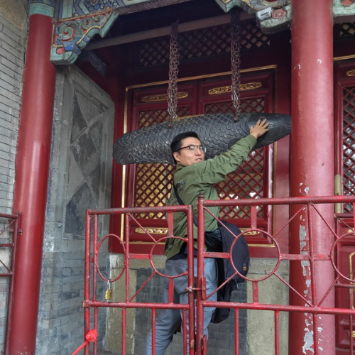

---
### Education

* Ph.D. student in Occupational and Environmental Health Sciences, Peking University, Beijing, China
* M.S. in Biostatistics, University of California, Los Angeles, Los Angeles, U.S.A.
* B.S. in Probability and Statistics, University of California San Diego, San Diego, U.S.A.

### Research Interests

My research focuses on understanding and quantifying human aging through epidemiological, multi-omics, and computational approaches.

* Integrating multi-omics data to investigate the molecular mechanisms and biological signatures of aging.
* Applying and validating existing measures of aging, including biological age, intrinsic capacity, and frailty, in population-based studies.
* Developing and validating predictive models for biological aging, age-related diseases, and other health outcomes.
* Applying advanced statistical methods and artificial intelligence to investigate the mechanisms and determinants of aging.
* Examining longitudinal aging trajectories and their associations with physical, cognitive, and mental health outcomes.
